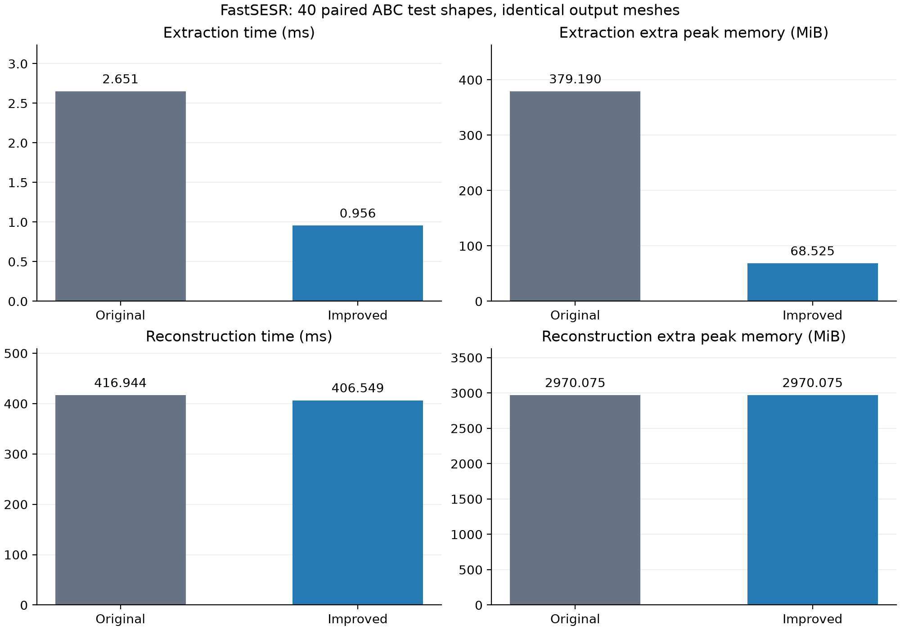

# FastSESR 按需构建候选三角形：真实数据对照实验

日期：2026-10-09（Asia/Shanghai）。本轮完成个人科研项目盘点、生产代码改进和真实数据对照。

## 项目选择

选中 `/home/syx/data/FastSESR`。本地数据约 23.94 GB，包含 2,256 个 ABC 训练网格和 6,771 对测试点云/GT；还有 FAUST、MGN、ScanNet、Matterport3D 等数据。两个阶段的预训练权重、重建与评估代码均存在。现有 `dcx` 环境能够直接执行原重建入口，全部活动网络参数已确认来自已有权重，因此能马上建立真实的对照实验。

PoNQ 虽然有约 74.93 GB 数据且完整覆盖 3,843 个训练 HDF5，但当前默认评估配置的外部数据路径不存在。这里选择的是当前训练数据、测试配对、预训练权重和可执行入口综合最齐全的项目，并不以磁盘容量作为唯一标准。

`dcx` 环境中当前流程需要的 torch、torchvision、timm、PyTorch3D、Open3D、pykdtree、numpy、scipy、sklearn 等已可用。requirements.txt 中的 wandb、gdown 未安装；当前代码没有使用它们，且本轮使用本地数据和权重。没有宣称整个 requirements 列表无缺项。

## 改进内容及原因

修改文件：`S2/ExtractFace.py` 的 `SurfExtract.forward()`，生产代码差异为 11 行新增、7 行删除。原实现完整保存在 `benchmarks/baselines/extract_face_before.py`。

原代码为每个中心点构建全部 `(K-1)^2` 个候选三角形，再按分数排序，后续只访问每条中心边的前两个候选。当 K=50 时，每点先构建 2,401 个三角形，最终此步骤只需要 98 个。改进后先排序 logits，再用前两名索引直接构建这 98 个三角形。

```python
neighbors = knn_indices[:, 1:]
other_vertices = torch.gather(
    neighbors[:, None, :].expand(-1, K-1, -1), 2, indices[:, :, :2])
sorted_candidate_triangles = torch.stack([
    knn_indices[:, :1, None].expand(-1, K-1, 2),
    neighbors[:, :, None].expand(-1, -1, 2),
    other_vertices,
], dim=-1)
```

仍使用原来的 torch.sort，确保并列分数的排序行为也相同。网络、权重、置信度阈值、角度判定和最终去重逻辑在对照中一致。这是一个减少无用张量构建和搬运的性能改进：实现小、无需重新训练或调参，适合最先落地。候选张量规模理论上缩小 24.5 倍；整个提取算子的显存还包括 logits 排序等操作，应以实测结果为准。

## 对照设计

- GPU：NVIDIA GeForce RTX 5090；Python 3.11；PyTorch 2.11.0+cu128，CUDA 12.8，使用现有 dcx 环境。
- 从全部 6,771 个 ABC 测试样本中，按原始点数排序，再等距选取 40 个排名，覆盖 1,004–19,669 个点。所有候选都有同名 GT，选择规则在看到新实验结果之前已保存。
- 使用现有 Stage-1 `trained_models/model_knn50.pth` 和 Stage-2 `runs/S2_train/model_best.pth`。初始化由原 `S2_reconstruct.py --use_loon_unet` 入口执行，当前网络 183 个 state_dict 键全部精确匹配权重；权重中有 29 个历史结构的多余键，原入口会忽略它们，对照沿用这一行为，没有活动参数缺失。
- KNN=50，chunk_size=2000，delta=0.0，rescale_delta=False，其余 U-Net 参数来自原权重 metadata；seed=20261009。
- 完整重建每种方法每样本重复 5 次，共 400 次测量；原实现/改进实现的顺序交替，每样本先预热。
- 表面提取在每个样本第一批真实网络 logits 上重复 25 次，共 2,000 次测量；每批最多 2,000 点。它是一个阶段测量，不能当作整个模型的推理速度。
- 耗时使用 perf_counter，测量开始/结束都调用 CUDA synchronize。完整重建计时覆盖 GPU 推理到 CPU 网格组装，不包含磁盘读取、点云预处理、权重加载或 PLY 写入。
- 显存为当前 PyTorch 进程在测量开始后的额外峰值 allocated 显存，单位 MiB；不等同于 nvidia-smi 的全卡占用。
- 时间汇总：先取每样本重复测量的中位数，再对 40 个样本求均值。显存先取每样本重复测量的最大值，再求均值。
- 每个样本两种输出都保存成 PLY；逐次验证顶点和三角形数组完全相同。实验辅助重建函数在首个样本上也与原 CLI 输出精确一致。

## 结果

| 指标 | 原实现 | 改进后 | 变化 |
|---|---:|---:|---:|
| 完整重建平均耗时_ms | 416.943971 | 406.548636 | 降低 2.49% |
| 完整重建平均额外峰值显存_MiB | 2970.075391 | 2970.075391 | 相同 |
| 表面提取平均耗时_ms | 2.650685 | 0.955707 | 降低 63.94% |
| 表面提取平均额外峰值显存_MiB | 379.189709 | 68.524829 | 降低 81.93% |
| CD1_x100 | 0.282570 | 0.282570 | 相同 |
| CD2_x1e5 | 0.541105 | 0.541105 | 相同 |
| F1_at_0.003 | 0.950050 | 0.950050 | 相同 |
| NC | 0.983246 | 0.983246 | 相同 |

四项精度的变化都严格为零，40/40 个输出网格完全相同。每个模型分别从 GT 和预测网格采样 100,000 个表面点，使用相同的明确随机种子；指标沿用 `eval/surf_acc.py` 的包围盒对角线归一化、CD1、CD2、F1 和绝对法向一致性定义。CD1 为双向平均欧氏距离之和乘 100；CD2 为双向平均平方距离之和乘 1e5；F1 距离阈值为 0.003；NC 为双向法向绝对点积均值。没有把输出完全一致描述为精度提升。

成对样本 bootstrap 的耗时降低 95% 区间：完整重建 2.18%–2.83%，提取阶段 63.24%–64.41%。完整重建有 38/40 个样本的中位数耗时降低。这些区间描述当前固定样本组的重采样变化，不能替代整个 ABC 测试集的统计结论。



## 结果的实际含义与限制

提取阶段减少了大量候选组合张量，因此该阶段耗时下降 63.94%，额外显存下降 81.93%。但完整重建耗时只下降 2.49%，完整流程峰值显存没有下降，说明总体成本仍主要出现在网络前向过程。不能将提取阶段的加速比例套用到整个模型。

本轮没有重新训练网络；这是对当前服务器项目与已有权重的无损性能优化。实验覆盖 40 个固定真实测试样本，没有覆盖全部 6,771 个测试模型，也没有证明所有数据集上的泛化收益。运行期间服务器还有其他 GPU 进程，计时采用成对交替顺序与重复中位数，但绝对耗时仍受共享负载影响。

## 回归测试与复现

6 项回归测试通过，覆盖不同 K、不同全局点索引、并列分数、无面输出、退化几何、非连续输入和 CPU/GPU。真实样本的每次完整重建和提取测量均做精确输出一致性检查。

```bash
cd /home/syx/data/FastSESR
OMP_NUM_THREADS=4 OPENBLAS_NUM_THREADS=4 MKL_NUM_THREADS=4 \
  /home/syx/data/miniconda3/envs/dcx/bin/python benchmarks/test_extract_face.py

OMP_NUM_THREADS=4 OPENBLAS_NUM_THREADS=4 MKL_NUM_THREADS=4 \
  /home/syx/data/miniconda3/envs/dcx/bin/python benchmarks/compare_extract_face.py \
  --manifest benchmarks/results/2026-10-09/selected_abc_test.json \
  --out benchmarks/results/2026-10-09/reproduction \
  --repeats 5 --extraction-repeats 25 --sample-count 100000

/home/syx/data/miniconda3/envs/dcx/bin/python benchmarks/summarize_extract_face.py \
  --out benchmarks/results/2026-10-09/reproduction
```

主要文件：`comparison.csv` / `comparison.md` 为对比表；`timing_raw.csv` 为 2,400 次原始测量；`per_sample_summary.csv` 为逐模型汇总；`accuracy_per_sample.csv` 为逐模型精度；`manifest.json` 为配置、源码/权重/数据 SHA256 和资源信息；`original/`、`improved/` 为两组 40 个真实输出网格；`original_cli_bootstrap.log` 记录原入口初始化；`comparison.png` / `comparison.svg` 为可导出的图表。

## 全部项目盘点

# 服务器科研项目盘点（2026-10-09）

本次检查个人目录 `/home/syx` 及其挂载到 `/media/data/syx` 的项目，发现 11 个科研/对比项目。`pytorch3d`、`nvdiffrast` 归为基础依赖；共享 ABC 原始数据有 18,451 个 OBJ。没有检查其他用户的项目。

环境判断区分通用依赖/算子检查与完整项目入口执行。只有 FastSESR 在本轮跑通原入口并执行正式对照；其余项目没有被宣称完成全流程复现。

| 项目 | 环境检查 | 数据与权重 | 判断 |
|---|---|---|---|
| DCx | dcx：torch、Open3D、pykdtree、PyTorch3D GPU KNN 已通过；项目专用提取算子未做本轮端到端验证 | 5 个输入 PLY、68 个检查点、109 个输出 PLY | 已有小规模实验，完整数据较少 |
| DefTet | defTet：torch、Kaolin、PyTorch3D GPU KNN、igl、tensorboardX 检查通过；已有 CUDA 迁移 | 默认 ShapeNet 路径不存在；已有 ABC 单模型实验和 5 个权重 | 环境较齐全；官方数据流程不完整 |
| FastSESR | dcx：核心模块与 GPU KNN 已实测；原入口已完成真实重建；当前网络全部参数来自预训练权重 | ABC train 2256 / test 6771；全部测试输入有同名 GT；另有 FAUST、MGN、ScanNet 等数据 | 最完整，选中 |
| NMC | 无同名专用环境：cutils 原生扩展未编译；未找到本地 cutils*.so | 两份预训练权重存在；groundtruth 无 HDF5 | 预处理数据和扩展缺失 |
| OffsetOPT | 可复用 dcx：通用依赖可复用 dcx；本轮未执行整个 OffsetOPT 重建入口 | 本项目目录仅 1 个点云和 1 个 GT；预训练模型存在 | 本地数据较少 |
| PoNQ | ponq：torch、PyTorch3D GPU KNN、igl、h5py 导入/算子检查通过 | 3843 个 HDF5 完整覆盖训练名单；约 74.9 GB；默认评估配置数据路径不存在 | 训练数据完整；评估路径待接入 |
| SALS | sals：torch CUDA、pyngpmesh、configargparse 已实测；torch_scatter 缺失，影响需要该包的分支 | 3 个输入 OBJ；有单模型输出和预处理缓存，未发现完整训练数据 | 单模型可复用；完整训练流程缺口 |
| TetWeave | tetweave：torch、Kaolin、PyTorch3D GPU KNN、tetgen、nvdiffrast 导入/检查通过 | 1 个示例 OBJ、3 个示例 PT；已有 3 次输出目录；未发现完整评测数据集 | 示例条件较齐全 |
| dcudf_capudf_compare | capudf_dcudf：torch CUDA、scipy、skimage、pyhocon 检查通过 | 2 组 NPY/NPZ 预处理数据；6 个权重；已有比较报告 | 单模型对比条件较齐全 |
| dmesh | dmesh：torch、Kaolin、PyTorch3D GPU KNN、igl 检查通过；专用 diffdt 算子本轮未做完整重建验证 | 3 个输入 OBJ；87 个检查点、91 个输出 OBJ | 已有小规模实验 |
| nsdudf | nsdudf：torch CUDA、igl、trimesh 检查通过；Cython MC 扩展已存在 | 2 个示例 OBJ、预训练 model.pt；dataset 目录只有列表文件 | 示例较齐全，大规模数据缺失 |

## 选择 FastSESR 的理由

FastSESR 包含训练数据、6,771 对 ABC 测试输入/真值、Stage-1 和 Stage-2 预训练模型、重建入口及评估代码。已有 ABC 重建结果和评估 CSV 也各覆盖 6,771 个模型。本轮在 `dcx` 环境中执行原重建入口成功，因此无需下载数据或重新训练即可做公平对照。

PoNQ 的数据体积更大，且 3,843 个 HDF5 完整覆盖其训练名单，但默认评估配置指向不存在的 `/data/nmaruani/DATASETS/`。数据体积大不等同于当前端到端实验条件最齐全。

证据文件：`inventory.json`、`environment_packages.json`、`env_*.json`、`ponq_dataset_coverage.json`、`dataset_supplement.json`、`project_readiness.json`。SALS 的扩展导入名实际是 `pyngpmesh`；补充探测已确认其可导入，不能根据初次 `ngpmesh` 名称探测的失败判定未安装。

